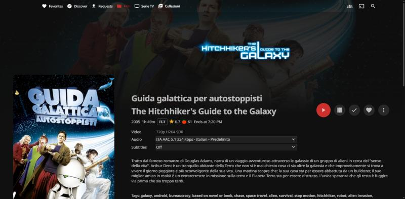
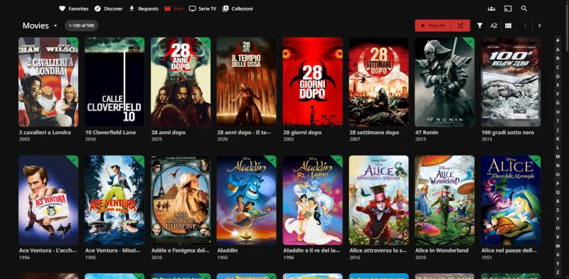
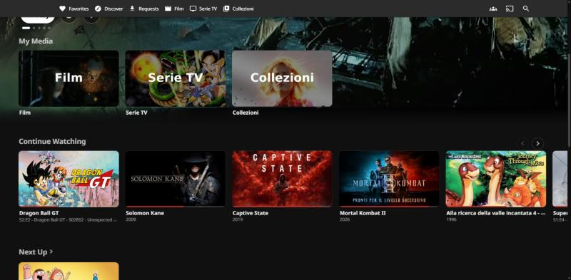

# Afterglow for Jellyfin

A calm, cinematic dark theme for the Jellyfin web client. Pure CSS: one file, no plugin, no build step.

| Details page | Library | Home shelves |
|---|---|---|
|  |  |  |

## What it changes

- **Details page**: a tall picture that fades into the page, a big title logo, the facts as quiet outlined chips, round glass buttons with a big red play button.
- **Posters**: rounded corners, a hairline, a soft lift under the pointer, a slim progress bar, and a small green corner for watched titles instead of a round badge.
- **Shelves**: text under the posters on the left, calmer colours, more air between rows, small round scroll arrows.
- **Top bar**: dark and blurred, so the page never shows through the menu text.
- **One accent colour** drives every button, bar and checkbox (Jellyfin 12 colours everything from `--jf-palette-primary-*`; Afterglow sets those from one variable).

## Install

Dashboard → **General** → **Custom CSS code**, paste:

```css
@import url("https://cdn.jsdelivr.net/gh/kiketorres98/jellyfin-afterglow@v12/afterglow.css");
```

Save, then reload the page (Ctrl+F5 if you still see the old look: Jellyfin keeps the CSS in memory).
To remove it, empty the box and save.

> Use the jsDelivr address, not `raw.githubusercontent.com`: GitHub serves raw files as plain text, which browsers refuse to use as a stylesheet.

## Make it yours

The theme has three settings. You change them in the **same box** where you pasted the `@import` (Dashboard → **General** → **Custom CSS code**), by adding a few lines **below** it. Do not touch the theme file itself: your lines stay yours when the theme is updated.

**1. Open the box.** Dashboard → General → scroll to **Custom CSS code**. It should already contain the `@import` line from the install step. Keep it as the very first line (CSS requires `@import` to come before everything else).

**2. Add your lines under it.** For example, a blue accent instead of red, so the whole box looks like this:

```css
@import url("https://cdn.jsdelivr.net/gh/kiketorres98/jellyfin-afterglow@v12/afterglow.css");

:root {
  --ag-accent: #3b82f6;
}
```

**3. Save and reload the page** (Ctrl+F5 if nothing changes). To go back to the default look, delete the `:root { ... }` block and save.

### The three settings

| Setting | What it changes | Default | Examples |
|---|---|---|---|
| `--ag-accent` | The colour of the big play button, buttons, progress bars, checkboxes, the selected tab and the focus ring. Lighter and darker shades are worked out from it automatically. | `#cb302d` (red) | `#3b82f6` blue, `#22c55e` green, `#a855f7` purple, `#f59e0b` amber |
| `--ag-played` | The small corner mark on titles you have already watched. | `#1f9d55` (green) | `#3b82f6` blue, `#f59e0b` amber |
| `--ag-radius` | How round the corners of posters and cards are. `0px` is square. | `10px` | `0px`, `6px`, `16px` |

You only need to write the settings you want to change; leave the others out. Colours are written as `#rrggbb` (any colour picker gives you one, for example the one in your browser's developer tools or any "hex colour picker" website). All three can go in the same block:

```css
:root {
  --ag-accent: #a855f7;
  --ag-played: #f59e0b;
  --ag-radius: 16px;
}
```

**Don't see the change?** After you save the custom CSS, Jellyfin and your browser can keep showing the old version for about five minutes. Wait a bit and reload the page (Ctrl+F5, or Cmd+Shift+R on a Mac). Other devices pick up the change the same way, a few minutes after their next reload.

If you also use the [Afterglow plugin](https://github.com/kiketorres98/jellyfin-plugin-afterglow), its side menu highlight follows `--ag-accent` too.

## Compatibility

- Tested with **Jellyfin web 12.3.0**, desktop layout, dark theme, Chrome. The phone layout was looked at only briefly.
- Plays well with the MediaBar and SeerrFin plugins (their own styles are left alone).
- Needs a browser with `color-mix()` and `backdrop-filter` (any Chrome, Edge, Firefox or Safari from 2023 on). Without them the theme still works but loses the lighter/darker accent shades and the blur.

## Notes for contributors

- Selectors follow the web client's own class names (`.card`, `.cardScalable`, `.itemDetailPage`, `.detailRibbon` …). Jellyfin sometimes forces values with `!important` (for example `margin: 0` on the detail buttons or the centred text under posters): the theme works around those on purpose, see the comments in `afterglow.css`.
- The theme is meant to be changed with variables, not by editing the file.

## License

MIT
